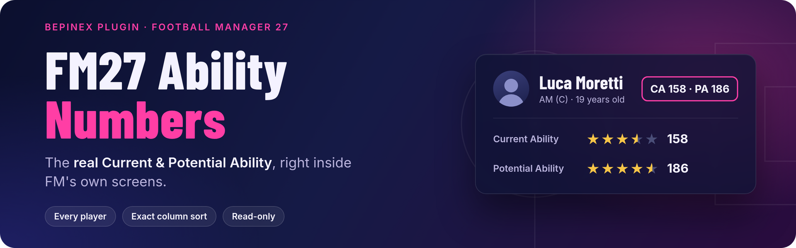
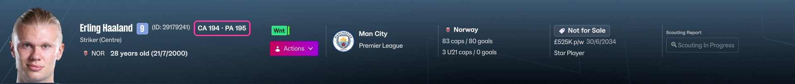
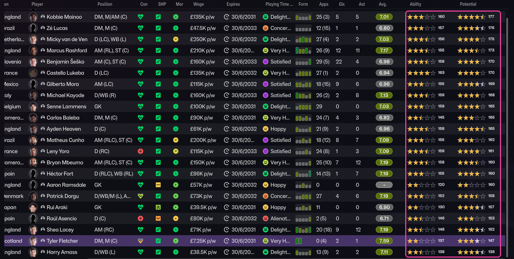
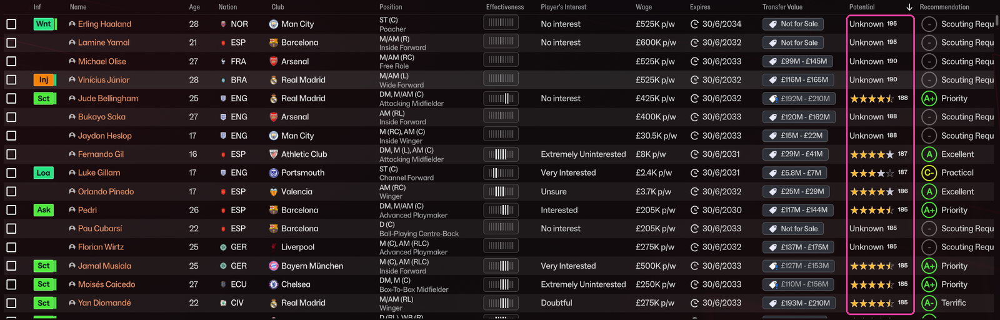
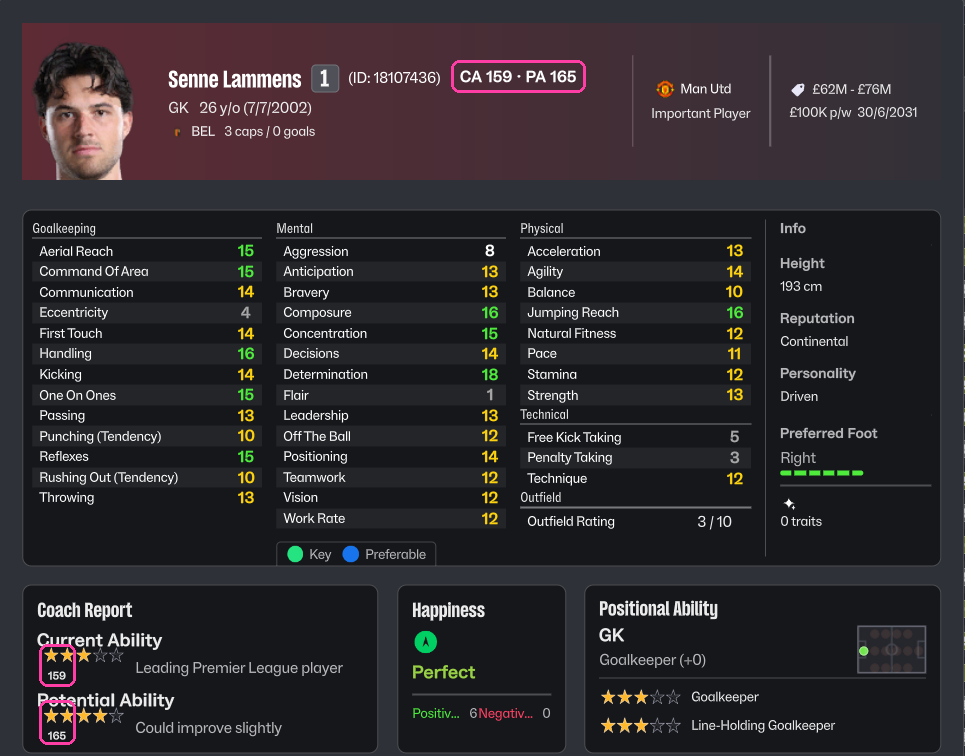

<p align="center">
  
</p>

<p align="center">
  <a href="https://github.com/da3gal/fm27-ability-numbers/releases/latest"></a>
  <a href="https://github.com/da3gal/fm27-ability-numbers/actions/workflows/ci.yml"></a>
  
  
  <a href="LICENSE"></a>
</p>

<p align="center">
  <b>Every player's real CA and PA, right inside Football Manager 27's own screens.</b><br>
  <a href="#install">Install</a> · <a href="#use">Use</a> · <a href="#faq">FAQ</a> · <a href="docs/configuration.md">Configuration</a> · <a href="docs/how-it-works.md">How it works</a>
</p>

---

A small [BepInEx](https://github.com/BepInEx/BepInEx) plugin that writes the real Current Ability and Potential Ability into FM's own UI, in FM's own font and layout. It puts the number next to the CA/PA stars (also where FM says "Unknown"), adds `CA 194 · PA 195` next to every player's name, and makes the Ability and Potential columns sort by the exact value. It only reads data and never changes your save.

<p align="center">
  
  
</p>

<details>
<summary>More screenshots</summary>
<br>
<p align="center">
  <br>
  <sub>Shortlist sorted by real PA. Unscouted players get their number next to "Unknown".</sub><br><br>
  <br>
  <sub>Hover popup with CA · PA next to the name and numbers by the coach-report stars.</sub>
</p>
</details>

## Install

Quit FM27 first, then paste one line into a terminal.

**Linux and Steam Deck** (Konsole in Desktop Mode)
```
curl -fsSL https://raw.githubusercontent.com/da3gal/fm27-ability-numbers/main/install.py | python3 -
```

**Windows** (PowerShell)
```
irm https://raw.githubusercontent.com/da3gal/fm27-ability-numbers/main/install.ps1 | iex
```

The installer finds FM27 in your Steam libraries and installs [BepInEx 6.0.0-be.793](https://builds.bepinex.dev/projects/bepinex_be) (checksum verified) if it is missing. It then downloads the latest plugin from [Releases](https://github.com/da3gal/fm27-ability-numbers/releases/latest). On Linux it also tells Proton to load BepInEx, so no launch option is needed. Start the game afterwards. The first start takes a few extra minutes while BepInEx prepares itself.

<details>
<summary>Manual install, other folders, uninstall</summary>

- If FM27 lives somewhere the installer can't find, download the script and run it with `--game-dir "/path/to/Football Manager 27"` (Linux) or `-GameDir "C:\path\to\Football Manager 27"` (Windows).
- To install by hand, extract the [BepInEx 6 Bleeding Edge](https://builds.bepinex.dev/projects/bepinex_be) zip (Unity IL2CPP win-x64, build 793 or newer) next to `fm.exe`. Put `FM27AbilityNumbers.dll` in `BepInEx/plugins/FM27AbilityNumbers/`. On Linux or Steam Deck, also set the Steam launch option `WINEDLLOVERRIDES="winhttp=n,b" %command%`.
- To uninstall, run the installer again with `--uninstall` (Linux, `curl -fsSL <url> | python3 - --uninstall`) or `-Uninstall` (Windows, `& ([scriptblock]::Create((irm <url>))) -Uninstall`). It removes the plugin, and BepInEx too when no other plugin uses it.
</details>

Tested on FM27 Steam build 26340721 with BepInEx 6.0.0-be.793 under Proton on Linux. Windows is expected to work but is untested so far.

## Use

| Where | What you get |
|---|---|
| Profile header, hover popup | `CA x · PA y` next to the player's name, for every player |
| CA/PA stars anywhere | The number beside the stars, or beside "Unknown" |
| Squad view, shortlist, search | Right-click a column header, then **Insert Column** → **Ability and Roles** → **Ability** / **Potential**. Click the header to sort by the real number. |
| Show or hide | **F9** |

Role ratings ("Centre Forward ★★★") get no number on purpose, because those stars are the player's ability in that role, not his CA. Everything else is in the [configuration](docs/configuration.md).

## FAQ

<details>
<summary><b>Does it change my save or the game?</b></summary>

No. It reads values from memory and draws labels on top of FM's UI. Uninstall it and the game is exactly as before.
</details>

<details>
<summary><b>Is it an editor like FMRTE or the In-Game Editor?</b></summary>

No, it only shows CA and PA, inside FM's own screens. It doesn't unlock the In-Game Editor and works fine next to FMRTE.
</details>

<details>
<summary><b>Will it break after an FM update?</b></summary>

Usually not, since it finds FM's classes by name rather than by fixed addresses. If an update does break it, the plugin switches itself off cleanly and the game runs normally. Please [open an issue](https://github.com/da3gal/fm27-ability-numbers/issues/new/choose) with `BepInEx/LogOutput.log`.
</details>

<details>
<summary><b>Nothing shows up. What now?</b></summary>

Check that `BepInEx/LogOutput.log` exists. If it doesn't, BepInEx isn't loading. On Linux, run the installer again or set the launch option from the manual install. If the log mentions `FM27 Ability Numbers` with an error, please report it.
</details>

<details>
<summary><b>Why no number for staff?</b></summary>

Only players are supported for now. Staff CA/PA comes from a different object.
</details>

## Contributing

Bug reports and ideas are very welcome through the [issue templates](https://github.com/da3gal/fm27-ability-numbers/issues/new/choose). Pull requests are welcome too. Please keep them small and run the tests first. [How it works](docs/how-it-works.md) covers the internals and building from source.

## Credits and license

The player memory layout comes from the research in [SiRRAHx/fm27-live-editor](https://github.com/SiRRAHx/fm27-live-editor). Built on [BepInEx](https://github.com/BepInEx/BepInEx), [Il2CppInterop](https://github.com/BepInEx/Il2CppInterop), [Cpp2IL](https://github.com/SamboyCoding/Cpp2IL) and [HarmonyX](https://github.com/BepInEx/HarmonyX).

[MIT](LICENSE). An unofficial fan project, not made by or affiliated with Sports Interactive or SEGA. Football Manager is a trademark of Sports Interactive / SEGA. Screenshots are from the author's own career save.
